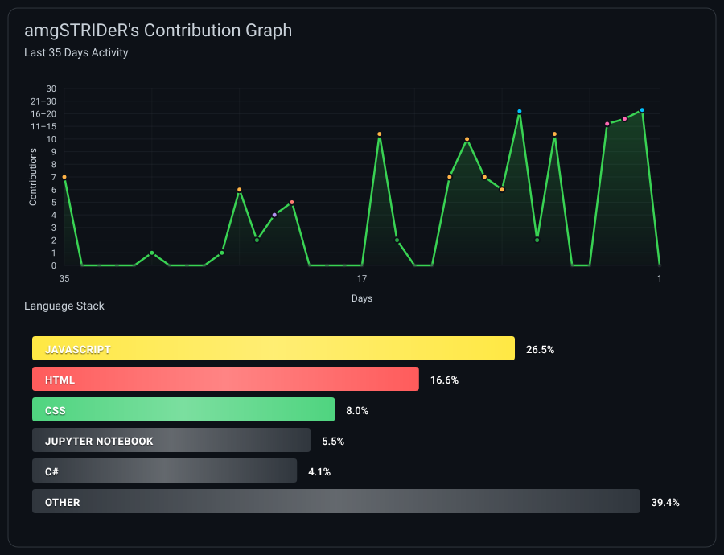
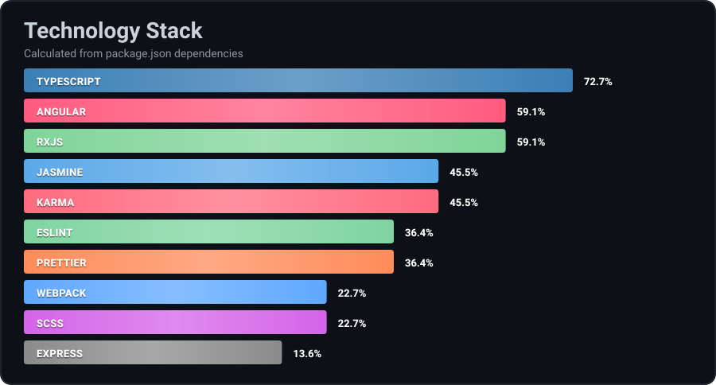

# Hi, I'm Aleksei 👋

**Software Engineer · Angular & TypeScript · AI & Agentic Development**

I build fast, maintainable web apps and AI-powered developer tools.
2.5 years at **EPAM Systems** shipping enterprise software for **SAP.com**,
now focused on LLM applications with the **Claude API** and **Model Context Protocol (MCP)**.

📍 [Montevideo], Uruguay (UTC-3) · 🌎 Open to remote roles ·
[LinkedIn](https://www.linkedin.com/in/aleksei-ovchinnikov/) ·
[Email](mailto:alex.ovchinnikov.dev@gmail.com)

---

## 🏆 Selected impact at EPAM (SAP.com)

- ⚡ Cut initial bundle size by **up to 40%** and Total Blocking Time by **52%** (Angular `@defer`, lazy loading, dependency pruning)
- 🔎 Architected reusable, embeddable search components with **Coveo** and **OpenSearch**
- 🔐 Migrated legacy auth to **Microsoft Entra ID** + Microsoft Graph API
- 🧩 Modernized enterprise Angular apps with **Signals** and **zoneless** change detection

---

## 🔧 Tech Stack

### Frontend

### Backend

### Databases

### APIs & Integrations

### Testing

### Cloud & Development Tools

### AI Development Tools

---

## 📜 Certifications

- [Claude Certified Architect – Foundations](https://verify.skilljar.com/c/2s955qp6frwv) — Anthropic
- [AWS Certified Developer – Associate](https://www.credly.com/badges/2f2512b5-3c4a-458c-b4ed-55fff5ae60c1/linked_in_profile)
- [Certified Mid-Level Angular Developer](https://certificates.dev/c/a3066249-06a6-427e-a183-5515d5b42185)
- [Coveo Architect Level 1](https://levelup.coveo.com/student/award/hqtGU7uYdyPc3fMds7sEVGDp)

---

📚 Training

- Anthropic: Building with the Claude API · MCP (Intro & Advanced) · Agent Skills · Claude Code in Action
- RS School: JavaScript/Front-end · Angular · Node.js · AWS Cloud Developer
- Netology: JavaScript Programmer

---

<!-- stats start -->
  

<!-- stats end -->

---

## 🚀 Educational Projects

Projects were developed in 2022-2023 independently without AI assistance during education in Rolling Scopes School. Recently published on GitHub with AI support for documentation. Current work involves closed-source enterprise applications (NDA-restricted).

<!--suppress HtmlDeprecatedAttribute -->
<table>
   <tr>
      <td width="50%" valign="top">
         <a href="https://github.com/amgSTRIDeR/Angular_YouTube-Client"><strong>1. Angular YouTube Client</strong></a> 
          
          Educational Angular 15 YouTube client (RS School): search, sorting/filtering, detailed view, custom cards, auth guards, NgRx, Angular Material.
      </td>
      <td width="50%" valign="top">
         <a href="https://github.com/amgSTRIDeR/RS_React"><strong>2. RS React</strong></a> 
          
          Educational React project - RS School course assignments and practice.
      </td>
   </tr>
   <tr>
      <td width="50%" valign="top">
         <a href="https://github.com/amgSTRIDeR/songbird"><strong>3. Songbird</strong></a> 
          
          Songbird - Can you name that game? A musical quiz game challenging players to identify video games by their iconic soundtracks and theme songs.
      </td>
      <td width="50%" valign="top">
         <a href="https://github.com/amgSTRIDeR/shelter"><strong>4. Shelter</strong></a> 
          
          Educational project: responsive website for "Cozy House" animal shelter. Practice in HTML, CSS, and JavaScript layout development.
      </td>
   </tr>
   <tr>
      <td width="50%" valign="top">
         <a href="https://github.com/amgSTRIDeR/online-zoo"><strong>5. Online Zoo</strong></a> 
          
          Educational web project featuring an online zoo platform with animal information, live stream previews, and donation system. Built with vanilla JavaScript, SCSS, and Webpack.
      </td>
      <td width="50%" valign="top">
         <a href="https://github.com/amgSTRIDeR/minesweeper"><strong>6. Minesweeper</strong></a> 
          
          Classic Minesweeper game recreation with timer, flag system, and customizable grid sizes.
      </td>
   </tr>
   <tr>
      <td width="50%" valign="top">
         <a href="https://github.com/amgSTRIDeR/momentum"><strong>7. Momentum</strong></a> 
          
          A feature-rich productivity dashboard with music player, todo list, weather widget, and daily quotes. Built with vanilla JavaScript.
      </td>
      <td width="50%" valign="top">
         <a href="https://github.com/amgSTRIDeR/travel"><strong>8. Travel</strong></a> 
          
          A small travel-themed web app built with vanilla JavaScript and SCSS.
      </td>
   </tr>
   <tr>
      <td width="50%" valign="top">
         <a href="https://github.com/amgSTRIDeR/EldritchHorror_codejam"><strong>9. Eldritch Horror Codejam</strong></a> 
          
          Deck builder and manager for the Eldritch Horror board game, created during a code jam.
      </td>
      <td width="50%" valign="top">
         <a href="https://github.com/amgSTRIDeR/Linear_Function"><strong>10. Linear Function</strong></a> 
          
         Web-based calculator for generating responsive CSS calc() functions using linear interpolation between viewport widths and pixel values.
      </td>
   </tr>
</table>

---

## 💡 Coding Challenges

<!-- leetcode start -->

  
<!-- leetcode end -->

---

## 🌐 Languages

-555555?style=for-the-badge&logoColor=white)

